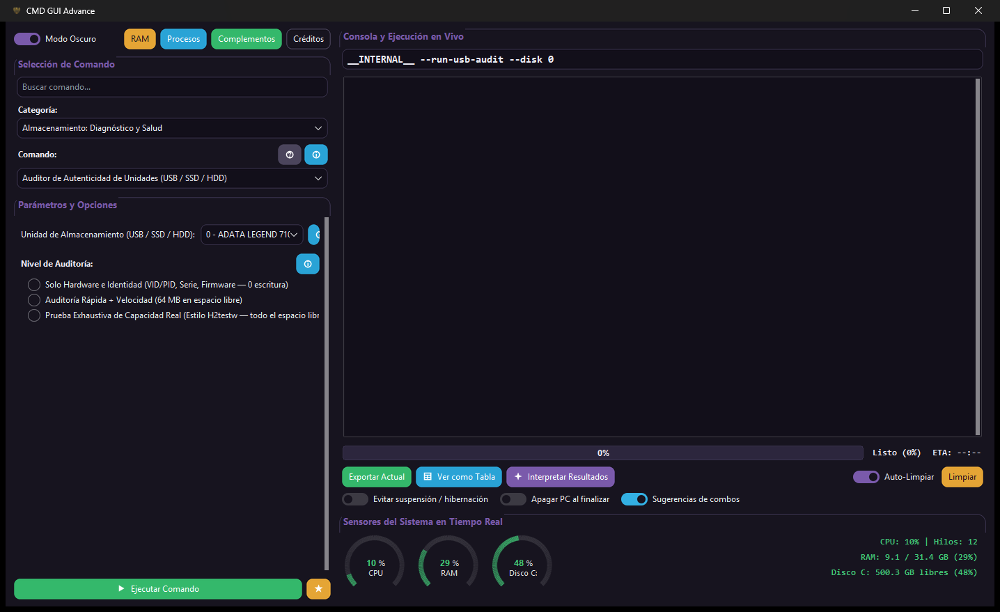
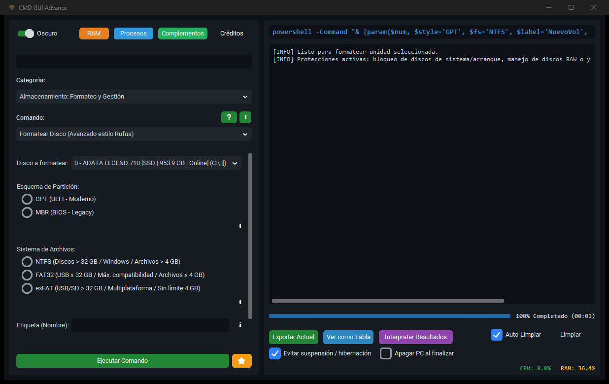
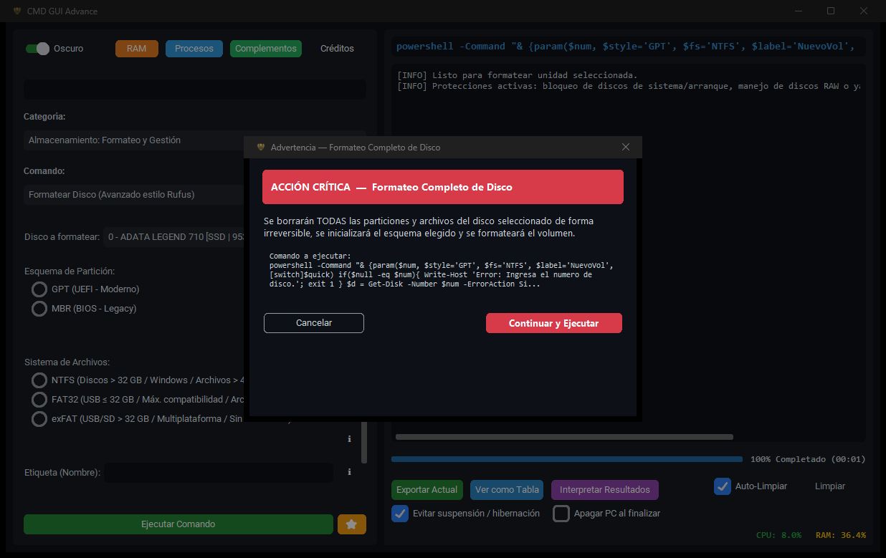
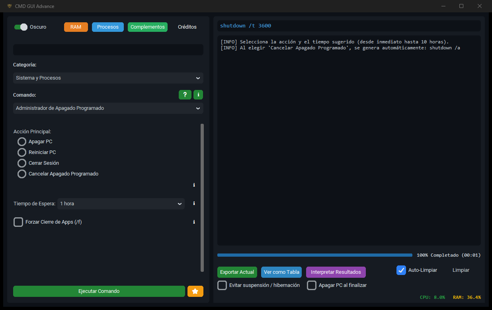
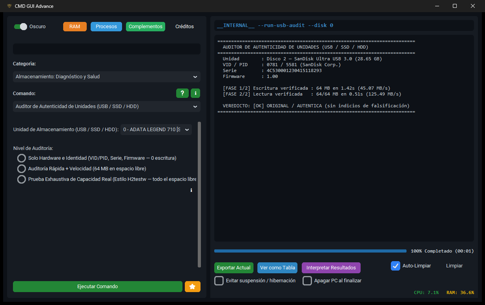

# GUI CMD ADVANCE

**GUI CMD ADVANCE** es una aplicación de escritorio para Windows desarrollada en Python (`CustomTkinter`) que ofrece una interfaz gráfica moderna, segura y portable para ejecutar operaciones avanzadas de administración de sistemas, diagnóstico de almacenamiento, redes, seguridad, recuperación de datos y procesamiento multimedia sin depender de la línea de comandos.



---

## Galería de Vistas Principales

### Formateo Avanzado estilo Rufus y Controles de Energía
Incluye selector de esquema GPT/MBR, recomendaciones de uso por capacidad en NTFS/FAT32/exFAT y casillas debajo de la consola para evitar suspensión/hibernación o apagar el equipo al finalizar.



### Sistema de Advertencias Pre-Ejecución
Antes de ejecutar cualquier operación modificadora o destructiva, la aplicación muestra un diálogo modal con el nivel de severidad, detalle de los cambios y vista previa del comando.



### Administrador de Apagado Programado (hasta 10 horas)
Selector desplegable con 16 tiempos sugeridos (desde inmediato hasta 10 horas) y cancelación limpia (`shutdown /a`).



### Auditor de Autenticidad de Unidades (USB / SSD / HDD)
Inspección de VID/PID, serie y firmware más pruebas de velocidad y capacidad real estilo H2testw.



### Reportes HTML Interactivos por Dominio
Exportación autocontenida con perfil visual automático, métricas extraídas, filtros por severidad, buscador en vivo y soporte de modo claro/oscuro.


---

## Características Principales

### 1. Diagnóstico y Gestión Avanzada de Almacenamiento
- **Formatear Disco (Avanzado estilo Rufus):** Limpieza, inicialización (GPT/MBR), particionado y formateo (NTFS, FAT32, exFAT) en un solo paso. Incluye protección contra borrado de discos de sistema/arranque, manejo automático de discos ya inicializados o `RAW`, respaldo con `diskpart` para unidades USB híbridas, validación del límite de 32 GB en FAT32 y recomendaciones de uso según capacidad directamente en la interfaz.
- **Auditor de Autenticidad de Unidades (USB / SSD / HDD):** Detecta memorias falsificadas o alteradas inspeccionando VID/PID real, fabricante, número de serie y firmware (modo hardware sin escritura), además de pruebas de velocidad y capacidad real estilo H2testw sobre espacio libre con limpieza automática.
- **Gestor de Atributos de Discos (HDD / SSD / USB):** Inspecciona y administra atributos de disco y volumen mediante `Diskpart` (quitar/aplicar `readonly`, `hidden`, etc.) con bloqueo de seguridad para la unidad del sistema.
- **Estado de Salud S.M.A.R.T. Avanzado:** Visor estilo CrystalDiskInfo conectado a WMI/CIM para evaluar salud física, temperatura y atributos de discos SATA y SSD NVMe.
- **Monitoreo en Vivo de Tareas de Almacenamiento:** Consulta `Get-StorageJob` en segundo plano para mostrar barra de progreso determinista en formateos y optimizaciones.

### 2. Seguridad Operativa y Control de Energía
- **Sistema de Advertencias Pre-Ejecución:** Diálogo modal de confirmación en dos niveles (**Crítico** y **Precaución**) en 35 comandos que modifican el sistema, red, permisos o eliminan datos, con vista previa del comando y exclusión automática en modos de solo lectura (`inspect` / `hardware`).
- **Controles de Energía Integrados (debajo de la consola):**
  - **Evitar suspensión / hibernación:** Utiliza `SetThreadExecutionState` (`ES_CONTINUOUS | ES_SYSTEM_REQUIRED`) para mantener el equipo activo durante tareas largas permitiendo que el monitor se apague normalmente para ahorrar energía.
  - **Apagar PC al finalizar:** Al terminar la ejecución inicia una cuenta regresiva cancelable de 60 segundos. Si la tarea finalizó con error, genera y guarda automáticamente un **reporte HTML en el Escritorio** antes de apagar para que el usuario pueda revisar el diagnóstico al encender el equipo.
- **Administrador de Apagado Programado:** Selector de 16 tiempos sugeridos (desde inmediato hasta 10 horas) y cancelación limpia (`shutdown /a`).

### 3. Motor de Reportes HTML Dinámicos por Dominio
- Exporta la salida de consola a reportes `.html` interactivos y autocontenidos con **5 perfiles visuales automáticos** (`multimedia`, `storage`, `network`, `security` y `system`).
- Incluye modo oscuro/claro, tarjetas de métricas extraídas por dominio, filtros por severidad (Éxitos, Avisos, Errores), buscador en tiempo real, salto al primer error, copia de vista, descarga en `.txt` e impresión/PDF.

### 4. Procesamiento Multimedia y Memoria de Tareas
- **Compresor de Multimedia:** Compresión por lotes o individual de imágenes y videos (Pillow + FFmpeg) con aceleración por hardware (NVENC, AMF, QSV o CPU), preservación de orientación EXIF y envío seguro a Papelera de Reciclaje.
- **Reparador y Analizador de Salud Multimedia:** Detecta y rescata imágenes truncadas y videos corruptos con control de hilos de CPU.
- **Buscador de Duplicados:** Localiza duplicados mediante hashing con vista previa.
- **Memoria de Tareas Persistente (Posponer / Reanudar):** Guarda el progreso por lotes para pausar tareas largas y reanudarlas omitiendo archivos ya procesados.

### 5. Bóveda IA, Productividad y Portabilidad
- **Intérprete de Reportes y Bóveda IA (Tren de Modelos):** Soporta Google Gemini, OpenAI, Anthropic Claude, Deepseek y Groq con conmutación automática ante errores de cuota (HTTP 429) y analizador local offline.
- **Herramientas Internas Adicionales:** Gestor de Procesos y Servicios (con detector de bloatware e historial), Bóveda de Credenciales (`cmdkey`), Limpieza Selectiva de Temporales, Búsqueda Avanzada de Texto (`findstr` con regex), Sanitizador de Nombres, Compresión/Verificación 7-Zip y Despliegue de Microsoft Office (ODT LTSC 2019/2021/2024).
- **Interfaz Moderna y Portable:** CustomTkinter con tema claro/oscuro, búsqueda global instantánea, sistema de `⭐ Favoritos`, monitoreo en vivo de CPU/RAM, gestor de complementos bajo demanda y persistencia aislada en `C:\GuiCmdAdvance`.

---

## Catálogo de Funciones (10 Categorías — 72 Comandos)

| # | Categoría | Comandos | Perfil de Reporte |
|---:|---|---:|---|
| 1 | **Redes y Conectividad** | 13 | `network` |
| 2 | **Sistema y Procesos** | 6 | `system` |
| 3 | **Reparación y Mantenimiento** | 5 | `system` |
| 4 | **Seguridad y Permisos** | 8 | `security` |
| 5 | **Archivos y Compresión** | 10 | `system` |
| 6 | **Almacenamiento: Formateo y Gestión** | 12 | `storage` |
| 7 | **Almacenamiento: Diagnóstico y Salud** | 7 | `storage` |
| 8 | **Recuperación de Datos** | 4 | `storage` |
| 9 | **Multimedia** | 4 | `multimedia` |
| 10 | **Instaladores Oficiales (Microsoft)** | 3 | `system` |

<details>
<summary>Ver listado completo de los 72 comandos por categoría</summary>

1. **Redes y Conectividad (13):** `Configuración de Red IP (ipconfig)`, `Probar Conectividad y Latencia (ping)`, `Rastrear Ruta de Red (tracert)`, `Diagnóstico de Ruta y Pérdida de Paquetes (pathping)`, `Estadísticas y Conexiones de Red (netstat)`, `Conexiones TCP en Vivo`, `Tabla de Enrutamiento`, `Ver Direcciones MAC de Red (getmac)`, `Tabla de Direcciones IP a MAC (arp)`, `Consultar DNS (nslookup)`, `Limpiar Caché DNS (Flush DNS)`, `Gestor Adaptador de Red`, `Contraseñas WiFi Guardadas`.
2. **Sistema y Procesos (6):** `Información Detallada del Equipo (systeminfo)`, `Listar Procesos en Ejecución (tasklist)`, `Finalizar / Cerrar Proceso (taskkill)`, `Administrador de Apagado Programado`, `Visor de Eventos del Sistema (Errores/Avisos)`, `Reporte de Batería (Laptops)`.
3. **Reparación y Mantenimiento (5):** `Reparar Archivos de Sistema Windows (sfc)`, `Reparar Imagen del Sistema Windows (DISM)`, `Reparar Windows Update`, `Reiniciar Explorador de Windows`, `Limpieza Selectiva de Temporales`.
4. **Seguridad y Permisos (8):** `Credenciales de Red (Bóveda)`, `Borrado Seguro Irreversible (SDelete)`, `Gestor de Firewall`, `Verificar Permisos de Archivo/Carpeta (icacls)`, `Conceder Control Total (icacls)`, `Tomar Posesión (takeown)`, `Quitar Solo Lectura (attrib)`, `Forzar Desbloqueo de Archivos`.
5. **Archivos y Compresión (10):** `Sanitizador de Nombres`, `Búsqueda Avanzada de Texto`, `Comprimir Archivos (7-Zip)`, `Descomprimir Archivo (7-Zip)`, `Analizar Integridad de Archivo`, `Clonado/Copia Segura (Robocopy)`, `Copiar Archivos y Carpetas (xcopy)`, `Listar Archivos y Carpetas (dir)`, `Ver Árbol de Directorios (tree)`, `Gestor de Atributos de Archivos (Ocultar/Sistema)`.
6. **Almacenamiento: Formateo y Gestión (12):** `Formatear Disco (Avanzado estilo Rufus)`, `Inicializar Disco Nuevo en GPT (Initialize-Disk)`, `Crear Partición y Formatear NTFS (New-Partition)`, `Borrar Todas las Particiones del Disco (Clear-Disk)`, `Optimizar / TRIM / Desfragmentar Discos`, `Gestor de Atributos de Discos (HDD/SSD/USB)`, `Explorar Disco (Abrir Carpeta)`, `Asignar Letra (Montar)`, `Quitar Letra (Desmontar)`, `Desconectar Disco (Offline)`, `Conectar Disco (Online)`, `Expulsar Unidad Seguramente`.
7. **Almacenamiento: Diagnóstico y Salud (7):** `Auditor de Autenticidad de Unidades (USB / SSD / HDD)`, `Escáner de Superficie y Sectores (HDD / SSD / USB)`, `Estado de Salud SMART Avanzado`, `Listar Discos Físicos y Salud (Get-PhysicalDisk)`, `Ver Discos Lógicos y Esquema GPT/MBR (Get-Disk)`, `Listar Volúmenes y Letras de Unidad (Get-Volume)`, `Info Discos Físicos`.
8. **Recuperación de Datos (4):** `Reparar Sistema de Archivos y Sectores (chkdsk)`, `Recuperación de Archivos (WINFR)`, `PhotoRec Código Abierto (Descargar y Abrir)`, `PhotoRec Código Abierto (Desinstalar)`.
9. **Multimedia (4):** `Compresor de Multimedia`, `Reparador de Multimedia`, `Analizador de Salud Multimedia`, `Buscador de Duplicados`.
10. **Instaladores Oficiales (Microsoft) (3):** `Desplegar Microsoft Office (ODT)`, `Descargar ISO Windows 11`, `Descargar ISO Windows 10`.

</details>

---

## Instalación y Uso (Ejecutable Portable)

Si solo deseas usar la aplicación, no necesitas instalar Python:
1. Descarga `Gui Cmd Advance.exe` o `Gui Cmd Advance Beta.exe` desde **Releases** (o desde `dist/` tras compilar localmente).
2. Ejecuta el archivo en Windows 10 / 11 (solicitará permisos de Administrador cuando se requieran operaciones de disco, red o sistema).
3. Los datos de usuario, favoritos, reportes y herramientas descargadas se almacenan automáticamente en `C:\GuiCmdAdvance`.

---

## Entorno de Desarrollo

### Requisitos
- Windows 10 / 11
- Python 3.12+ (probado en Python 3.14)

### Configuración Local
```powershell
git clone https://github.com/GoldenFenix92/gui-cmd-advance.git
cd gui-cmd-advance

python -m venv .venv
.\.venv\Scripts\activate
pip install -r requirements.txt
python main.py
```

### Pruebas Automatizadas
El proyecto cuenta con una suite de **40 pruebas unitarias** en `tests/` que validan:
- Integridad de módulos, `HIDDEN_IMPORTS` de PyInstaller y compatibilidad con `sys.frozen=True` / `sys.stdout=None`.
- Ausencia de comandos duplicados y validez de sintaxis AST de todos los scripts PowerShell en `resources/commands_config.json`.
- Mapeo de perfiles de reportes HTML, esquema de advertencias pre-ejecución y controles de energía (`power_manager`).
- Higiene de código (sin emojis decorativos, sin `except:` desnudos y `CREATE_NO_WINDOW` en todos los subprocesos).
- Módulos críticos: compresor multimedia, atributos de disco (`Diskpart`) y auditor de autenticidad USB.

```powershell
.\.venv\Scripts\python.exe -m unittest discover -s tests -v
```

### Compilación del Ejecutable (`.exe` Portable)
El script `scripts/build_exe.py` calcula automáticamente la versión desde el historial de Git (`1.0.<commits>`), genera `version.py` y `version_info.txt`, y empaqueta la app con PyInstaller (`--onefile --windowed`):

```powershell
.\.venv\Scripts\python.exe scripts\build_exe.py
```

El ejecutable resultante se genera en `dist/Gui Cmd Advance Beta.exe` (o `dist/Gui Cmd Advance.exe`).

---

## Arquitectura del Proyecto

```text
gui-cmd-advance/
├── main.py                      # Punto de entrada y enrutador CLI (--run-*)
├── gui_app.py                   # Interfaz principal CustomTkinter, alertas y controles de energía
├── functions/                   # Módulos internos (almacenamiento, multimedia, red, IA, energía, reportes)
│   ├── cmd_executor.py          # Ejecución asíncrona de comandos y resolución __INTERNAL__
│   ├── power_manager.py         # Anti-suspensión (Win32) y apagado programado
│   ├── report_generator.py      # Motor de reportes HTML por dominio
│   ├── usb_auditor.py           # Auditoría de autenticidad y capacidad real (USB/SSD/HDD)
│   ├── disk_attributes.py       # Gestor de atributos de discos/volúmenes vía Diskpart
│   ├── compressor.py            # Compresor multimedia con memoria de tareas
│   └── ...
├── resources/
│   ├── commands_config.json     # Catálogo declarativo de categorías, comandos, args y warnings
│   ├── custom_github_theme.json # Tema visual CustomTkinter
│   └── templates/
│       └── base_report.html     # Plantilla HTML interactiva de reportes
├── scripts/
│   └── build_exe.py             # Automatización de compilación PyInstaller
└── tests/                       # Suite de pruebas unitarias e integridad
```

---

## Cómo Agregar Nuevos Comandos

Los comandos se declaran en `resources/commands_config.json`. Cada entrada soporta argumentos dinámicos (`checkbox`, `entry`, `dropdown` con strings o pares `{"name", "value"}`, `radio_group`, `disk_dropdown`, `drive_dropdown`, etc.) y un bloque opcional `"warning"` para confirmación previa:

```json
{
    "name": "Ejemplo de Comando",
    "description": "Descripción visible en el botón de información.",
    "command": "powershell -Command \"...\"",
    "warning": {
        "level": "caution",
        "title": "Confirmación de operación",
        "message": "Explica claramente qué cambios se aplicarán al sistema.",
        "skip_if_flag_in": ["--mode readonly"]
    },
    "args": [
        {
            "name": "Tiempo de Espera",
            "flag": "/t",
            "type": "dropdown",
            "options": [
                { "name": "15 minutos", "value": "900" },
                { "name": "1 hora", "value": "3600" }
            ],
            "value": "1 hora",
            "description": "Tiempo sugerido antes de ejecutar la acción."
        }
    ]
}
```

- **Scripts internos de Python:** usa `__INTERNAL__ --run-tu-modulo`, registra el flag en `main.py` y agrega el módulo a `HIDDEN_IMPORTS` en `scripts/build_exe.py`.

---

## Créditos y Autoría

- **Desarrollador Principal:** Golden Fenix
- **Copyright:** © 2026 GoldenFenix. Todos los derechos reservados.
