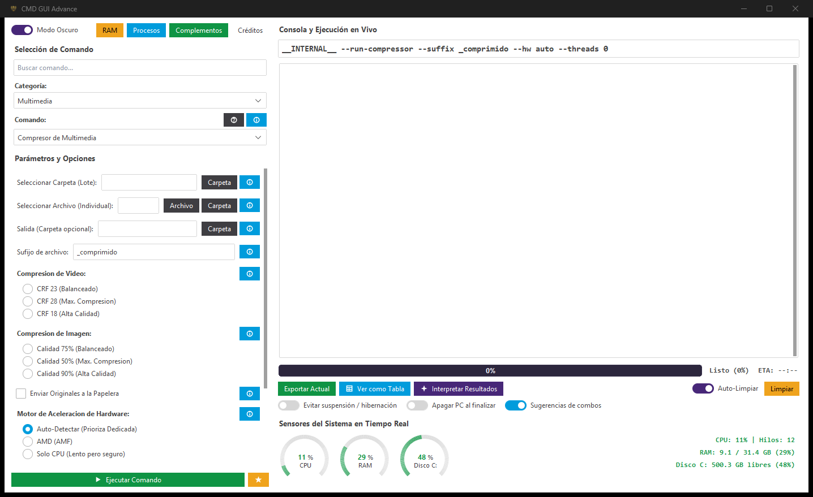
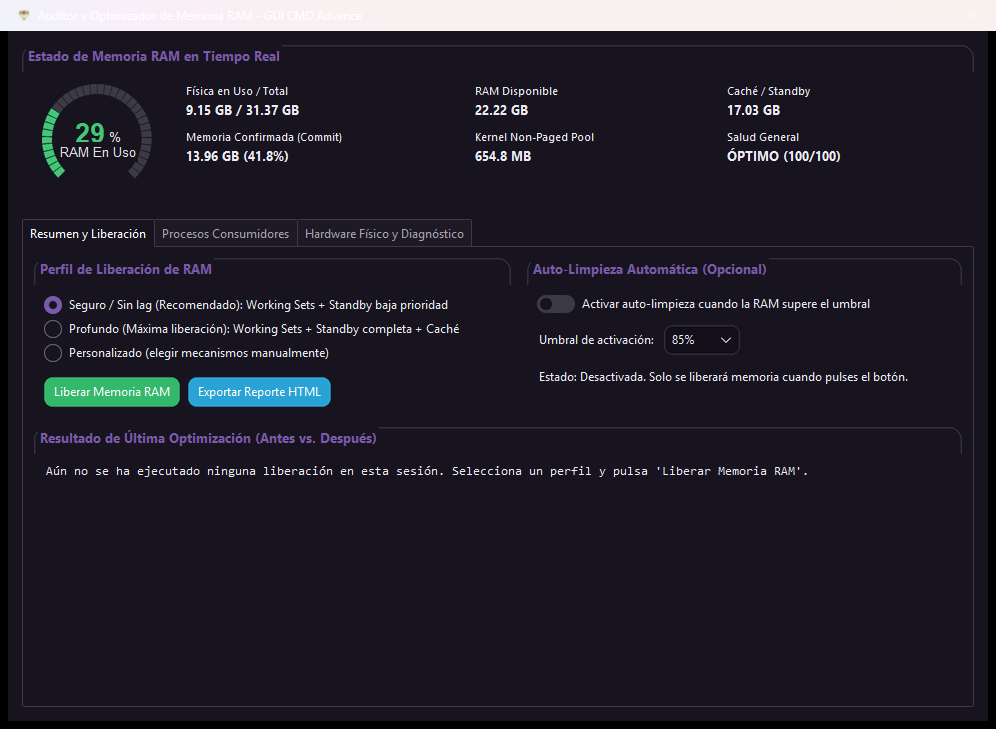
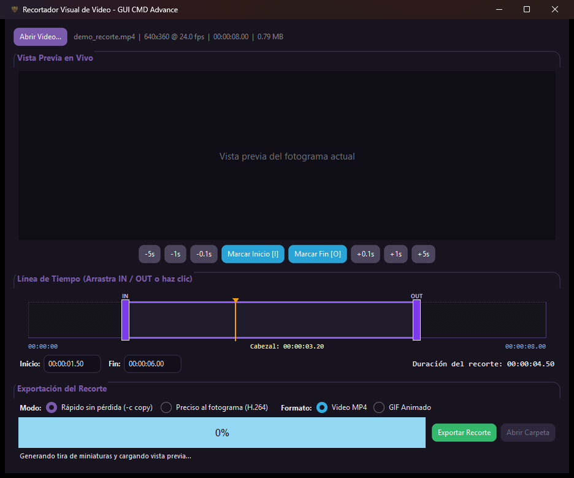
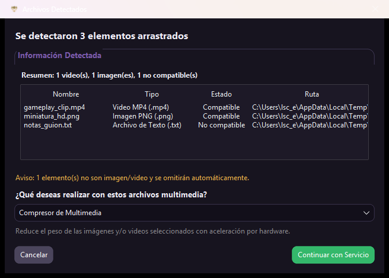
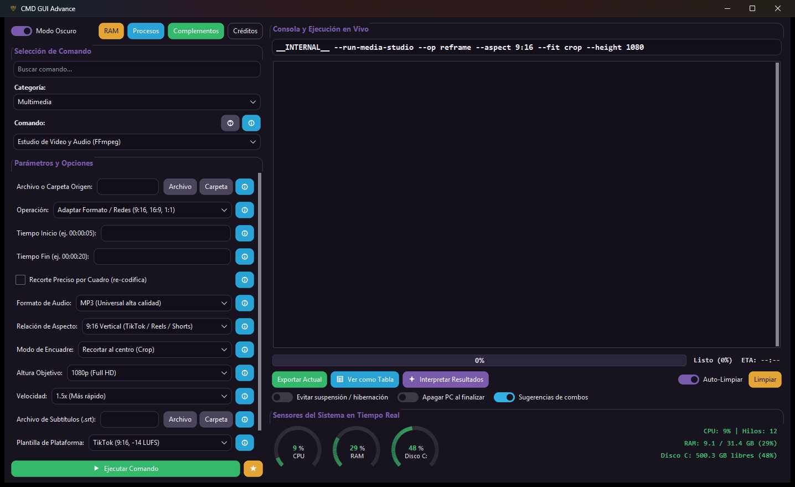
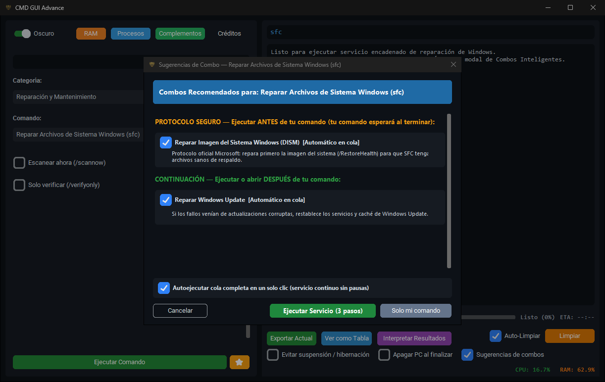
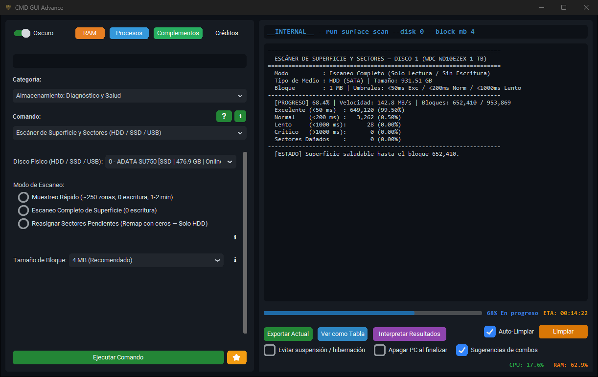
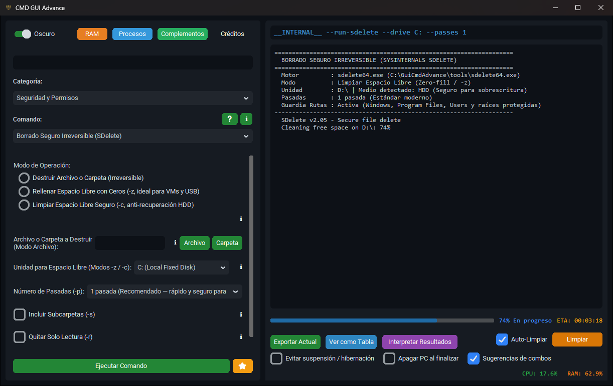
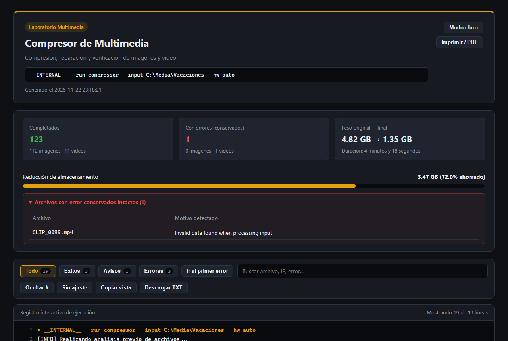

# GUI CMD ADVANCE

**GUI CMD ADVANCE** (`v2.3.0-beta`) es una aplicación de escritorio portable para Windows desarrollada en Python (**`ttkbootstrap 2.2.7`**) con temas oficiales **Pulse Dark / Pulse Light** y diseño moderno redondeado 9-slice. Ofrece una interfaz gráfica rápida, segura y sin consola externa para ejecutar operaciones avanzadas de administración de sistemas, auditoría de memoria RAM, diagnóstico de almacenamiento, redes, seguridad, recuperación de datos y edición/procesamiento multimedia con **FFmpeg**.


---

## Galería de Vistas Principales (v2.3.0-beta)

### Tema Claro Pulse Light (Alternancia Instantánea Oscuro ↔ Claro)
Interruptor nativo en la barra superior para cambiar al instante entre **Pulse Dark** y **Pulse Light** sin lag ni reacomodo de contenedores, conservando tarjetas, botones y barras redondeadas de alto contraste.



### Auditor y Optimizador Profesional de Memoria RAM
Herramienta nativa Win32/NT (`EmptyWorkingSet`, `NtSetSystemInformation` para Standby/Modified List, `SetSystemFileCacheSize` y `GetPerformanceInfo`) con auditoría de módulos físicos DIMM, telemetría de *Kernel Pools*, ranking de procesos agrupados por aplicación, perfiles **Seguro / Profundo / Personalizado**, **auto-limpieza opcional por umbral** y exportación a **Reporte HTML**.



### Recortador Visual de Video (Línea de Tiempo Interactiva)
Editor visual interactivo con monitor de vista previa en vivo, tira automática de 10 miniaturas (*filmstrip*), doble tirador arrastrable (`IN` / `OUT`), navegación precisa (`±0.1s`, `±1s`, `±5s` y teclas `I`/`O`) y exportación a **MP4 sin pérdida (`-c copy`)**, **MP4 preciso (`H.264`)** o **GIF Animado** sin sobrescribir jamás el original.



### Arrastrar y Soltar (Drag & Drop) Nativo Multi-Archivo
Arrastra uno o varios archivos directamente desde el Explorador de Windows sobre la ventana principal (compatible incluso con sesiones de Administrador vía UIPI). Detecta nombre, ruta y tipo, filtra archivos multimedia compatibles, avisa cuando el servicio elegido es exclusivo para video y carga lotes grandes vía `--input-list`.



### Estudio de Video y Audio (FFmpeg) + Complemento FFmpeg Skill
Comando unificado con campos dinámicos (`visible_when`) para inspeccionar metadatos (`ffprobe`, VFR/HDR), recortar, extraer/normalizar audio (`-14 LUFS`), quitar sonido sin recodificar, adaptar a `9:16` / `16:9` / `1:1`, crear GIFs, cambiar velocidad, convertir **HDR -> SDR** y ejecutar operaciones avanzadas del complemento descargable **FFmpeg Skill** (quitar silencios, estabilizar, subtítulos `.srt` y plantillas TikTok/Reels/Shorts/YouTube).



### Combos Inteligentes (Antes / Después) y Cola Encadenada
32+ comandos del catálogo sugieren flujos recomendados antes (*Protocolo Seguro*) y después (*Continuación*), con herencia automática de disco/unidad/ruta/tipo multimedia, advertencia unificada y ejecución continua en un solo clic.



### Escáner de Superficie y Sectores (HDD / SSD / USB)
Clasificación de bloques por latencia en tiempo real (`<50 ms` Excelente, `<200 ms` Normal, `<1000 ms` Lento, `>1000 ms` Crítico y sectores dañados) con modos de muestreo rápido, escaneo completo y reasignación (*Remap*) protegida contra SSD/NVMe y discos de sistema.



### Borrado Seguro Irreversible (Sysinternals SDelete)
Integración bajo demanda de Sysinternals SDelete para destrucción irreversible de archivos/carpetas o limpieza de espacio libre (`-z` / `-c`), con detección de SSD, protección de rutas críticas de Windows y progreso en vivo.



### Reportes HTML Interactivos por Dominio
Exportación autocontenida con perfil visual automático, métricas extraídas, filtros por severidad, buscador en vivo y soporte de modo claro/oscuro.



---

## Características Principales

### 1. Suite Multimedia Profesional + Drag & Drop Nativo
- **Arrastrar y Soltar (Drag & Drop) Multi-Archivo:** Motor nativo Win32 (`SetWindowSubclass` + `WM_DROPFILES` + `ChangeWindowMessageFilterEx` para sesiones elevadas como Administrador) sin librerías externas. Detecta 1 o múltiples archivos, muestra Nombre, Ruta y Tipo en un modal moderno, filtra imágenes/videos compatibles y muestra confirmación explícita para servicios exclusivos de video.
- **Recortador Visual de Video (Línea de Tiempo):** Vista previa de fotogramas en vivo, tira de miniaturas (*filmstrip*), doble tirador `IN`/`OUT`, soporte de cola multi-video y exportación a MP4 sin pérdida, MP4 preciso o GIF.
- **Estudio de Video y Audio (FFmpeg):** 14 operaciones unificadas (9 nativas + 5 avanzadas bajo demanda con el complemento **FFmpeg Skill**): `ffprobe`, recorte, extracción MP3/M4A/WAV, normalización `-14 LUFS`, mute sin pérdida, reencuadre `9:16`/`16:9`/`1:1`, GIF Lanczos, velocidad sincronizada, HDR -> SDR, eliminación de silencios, estabilización, subtítulos SRT y plantillas sociales.
- **Compresor de Multimedia:** Compresión individual o por lotes (`--input-list`) con aceleración GPU (NVENC, AMF, QSV o CPU), **peso objetivo opcional (`--max-mb`)**, corrección automática de dimensiones pares, preservación EXIF y envío seguro a Papelera de Reciclaje.
- **Reparador y Analizador de Salud Multimedia:** Escaneo previo automático que guarda un **manifiesto atómico incremental** para reparar exclusivamente archivos corruptos (sin tocar archivos sanos), filtros separados (`Solo Videos` / `Solo Imágenes` / `Todos`), referencias independientes para video/imagen, reanudación tras interrupciones y limpieza automática del manifiesto al concluir.
- **Buscador de Duplicados:** Localiza archivos repetidos o dañados mediante hashing y vista previa.

### 2. Auditoría y Optimización Profesional de Memoria RAM
- **Auditoría Física y de Kernel:** Consulta módulos DIMM/SODIMM (ranuras, fabricante, tipo DDR, velocidad real vs. nominal, detección Single-Channel) vía WMI/CIM y contadores de kernel (`Paged` / `Non-Paged Pool`, `Commit Charge`, caché del sistema) vía `GetPerformanceInfo`.
- **Liberación Nativa Medible (Antes vs. Después):** Habilita `SeProfileSingleProcessPrivilege` y `SeIncreaseQuotaPrivilege` para ejecutar `EmptyWorkingSet` (excluyendo procesos críticos del kernel), purga de Standby/Modified List (`NtSetSystemInformation`) y vaciado de caché de archivos (`SetSystemFileCacheSize`), con historial persistente, **auto-limpieza opcional por umbral** y exportación a **Reporte HTML**.

### 3. Diagnóstico y Gestión Avanzada de Almacenamiento
- **Escáner de Superficie y Sectores (HDD / SSD / USB):** Acceso directo Win32 (`CreateFileW`) con clasificación de latencias y *Remap* protegido contra SSD/NVMe y discos de sistema.
- **Reparar Sistema de Archivos y Sectores (`chkdsk`):** Soporte para `/r`, `/b`, `/scan`, `/x` y detección `RAW`.
- **Formatear Disco (Avanzado estilo Rufus):** Limpieza, GPT/MBR, NTFS/FAT32/exFAT con protección de discos de sistema y progreso real vía `Get-StorageJob`.
- **Auditor de Autenticidad de Unidades (USB / SSD / HDD):** Inspección de VID/PID, serie y firmware más prueba de capacidad real estilo H2testw.
- **Gestor de Atributos de Discos (Diskpart) y Visor S.M.A.R.T. Avanzado:** Gestión de `readonly`/`hidden` con diagnóstico de bloqueo por hardware y visor de salud física estilo CrystalDiskInfo.

### 4. Seguridad Operativa, Combos Inteligentes y Control de Energía
- **Combos Inteligentes (Antes / Después) y Cola Encadenada:** Sugerencias contextuales con herencia de parámetros (`{disk}`, `{drive}`, `{path}`, `{recursive_flag}`, `{media_type}`), advertencia unificada y ejecución encadenada en 1 clic.
- **Borrado Seguro Irreversible (Sysinternals SDelete):** Plugin descargable bajo demanda con guardia de rutas críticas y aviso para SSD.
- **Controles de Energía Integrados:** Anti-suspensión (`SetThreadExecutionState`) y apagado automático al finalizar con cuenta regresiva cancelable de 60 s y reporte HTML automático si hubo error.

### 5. Bóveda IA, Complementos Bajo Demanda y Versionado SemVer
- **Intérprete de Reportes y Bóveda IA (DPAPI + `.aivault`):** Soporta Google Gemini, OpenAI, Anthropic Claude, Deepseek, Groq y modelos locales (**Ollama / LM Studio**) con respaldo cifrado y analizador offline.
- **Gestor de Complementos Bajo Demanda:** Instala en 1 clic `FFmpeg (ffmpeg.exe + ffprobe.exe)`, `FFmpeg Skill (42 Herramientas Avanzadas)`, `7-Zip`, `Sysinternals SDelete` y `Office Deployment Tool (ODT)` en `C:\GuiCmdAdvance\tools\`.
- **Versionado Canónico SemVer y Auto-Actualizador Markdown:** Fuente única de verdad en `VERSION`, detección automática de incrementos por commits Git (`feat:`/`fix:`/`BREAKING`), selección interactiva Beta/Estable en el compilador y notas de versión renderizadas en Markdown nativo.

---

## Catálogo de Funciones (10 Categorías — 75 Comandos)

| # | Categoría | Comandos | Perfil de Reporte |
|---:|---|---:|---|
| 1 | **Redes y Conectividad** | 13 | `network` |
| 2 | **Sistema y Procesos** | 7 | `system` |
| 3 | **Reparación y Mantenimiento** | 5 | `system` |
| 4 | **Seguridad y Permisos** | 8 | `security` |
| 5 | **Archivos y Compresión** | 10 | `system` |
| 6 | **Almacenamiento: Formateo y Gestión** | 12 | `storage` |
| 7 | **Almacenamiento: Diagnóstico y Salud** | 7 | `storage` |
| 8 | **Recuperación de Datos** | 4 | `storage` |
| 9 | **Multimedia** | 6 | `multimedia` |
| 10 | **Instaladores Oficiales (Microsoft)** | 3 | `system` |

<details>
<summary>Ver listado completo de los 75 comandos por categoría</summary>

1. **Redes y Conectividad (13):** `Configuración de Red IP (ipconfig)`, `Probar Conectividad y Latencia (ping)`, `Rastrear Ruta de Red (tracert)`, `Diagnóstico de Ruta y Pérdida de Paquetes (pathping)`, `Estadísticas y Conexiones de Red (netstat)`, `Conexiones TCP en Vivo`, `Tabla de Enrutamiento`, `Ver Direcciones MAC de Red (getmac)`, `Tabla de Direcciones IP a MAC (arp)`, `Consultar DNS (nslookup)`, `Limpiar Caché DNS (Flush DNS)`, `Gestor Adaptador de Red`, `Contraseñas WiFi Guardadas`.
2. **Sistema y Procesos (7):** `Información Detallada del Equipo (systeminfo)`, `Listar Procesos en Ejecución (tasklist)`, `Finalizar / Cerrar Proceso (taskkill)`, `Administrador de Apagado Programado`, `Visor de Eventos del Sistema (Errores/Avisos)`, `Reporte de Batería (Laptops)`, `Auditor y Optimizador de Memoria RAM`.
3. **Reparación y Mantenimiento (5):** `Reparar Archivos de Sistema Windows (sfc)`, `Reparar Imagen del Sistema Windows (DISM)`, `Reparar Windows Update`, `Reiniciar Explorador de Windows`, `Limpieza Selectiva de Temporales`.
4. **Seguridad y Permisos (8):** `Credenciales de Red (Bóveda)`, `Borrado Seguro Irreversible (SDelete)`, `Gestor de Firewall`, `Verificar Permisos de Archivo/Carpeta (icacls)`, `Conceder Control Total (icacls)`, `Tomar Posesión (takeown)`, `Quitar Solo Lectura (attrib)`, `Forzar Desbloqueo de Archivos`.
5. **Archivos y Compresión (10):** `Sanitizador de Nombres`, `Búsqueda Avanzada de Texto`, `Comprimir Archivos (7-Zip)`, `Descomprimir Archivo (7-Zip)`, `Analizar Integridad de Archivo`, `Clonado/Copia Segura (Robocopy)`, `Copiar Archivos y Carpetas (xcopy)`, `Listar Archivos y Carpetas (dir)`, `Ver Árbol de Directorios (tree)`, `Gestor de Atributos de Archivos (Ocultar/Sistema)`.
6. **Almacenamiento: Formateo y Gestión (12):** `Formatear Disco (Avanzado estilo Rufus)`, `Inicializar Disco Nuevo en GPT (Initialize-Disk)`, `Crear Partición y Formatear NTFS (New-Partition)`, `Borrar Todas las Particiones del Disco (Clear-Disk)`, `Optimizar / TRIM / Desfragmentar Discos`, `Gestor de Atributos de Discos (HDD/SSD/USB)`, `Explorar Disco (Abrir Carpeta)`, `Asignar Letra (Montar)`, `Quitar Letra (Desmontar)`, `Desconectar Disco (Offline)`, `Conectar Disco (Online)`, `Expulsar Unidad Seguramente`.
7. **Almacenamiento: Diagnóstico y Salud (7):** `Auditor de Autenticidad de Unidades (USB / SSD / HDD)`, `Escáner de Superficie y Sectores (HDD / SSD / USB)`, `Estado de Salud SMART Avanzado`, `Listar Discos Físicos y Salud (Get-PhysicalDisk)`, `Ver Discos Lógicos y Esquema GPT/MBR (Get-Disk)`, `Listar Volúmenes y Letras de Unidad (Get-Volume)`, `Info Discos Físicos`.
8. **Recuperación de Datos (4):** `Reparar Sistema de Archivos y Sectores (chkdsk)`, `Recuperación de Archivos (WINFR)`, `PhotoRec Código Abierto (Descargar y Abrir)`, `PhotoRec Código Abierto (Desinstalar)`.
9. **Multimedia (6):** `Compresor de Multimedia`, `Recortador Visual de Video (Línea de Tiempo)`, `Estudio de Video y Audio (FFmpeg)`, `Reparador de Multimedia`, `Analizador de Salud Multimedia`, `Buscador de Duplicados`.
10. **Instaladores Oficiales (Microsoft) (3):** `Desplegar Microsoft Office (ODT)`, `Descargar ISO Windows 11`, `Descargar ISO Windows 10`.

</details>

---

## Instalación y Uso (Ejecutable Portable)

Si solo deseas usar la aplicación, no necesitas instalar Python, Git ni Node.js:
1. Descarga `Gui Cmd Advance Beta.exe` (o `Gui Cmd Advance.exe`) desde **Releases**.
2. Ejecuta el archivo en Windows 10 / 11 (solicitará permisos de Administrador cuando se requieran operaciones de disco, RAM, red o sistema).
3. Los datos de usuario, favoritos, reportes y complementos descargados (`FFmpeg`, `FFmpeg Skill`, `7-Zip`, `SDelete`, `ODT`) se almacenan automáticamente en `C:\GuiCmdAdvance`.

---

## Entorno de Desarrollo

### Requisitos
- Windows 10 / 11
- Python 3.12+ (probado en Python 3.14)

### Configuración Local
```powershell
git clone https://github.com/GoldenFenix92/gui-cmd-advance.git
cd gui-cmd-advance

python -m venv .venv
.\.venv\Scripts\activate
pip install -r requirements.txt
python main.py
```

### Pruebas Automatizadas
El proyecto cuenta con una suite de **101 pruebas unitarias** en `tests/` que validan:
- Integridad de módulos, `HIDDEN_IMPORTS` de PyInstaller, flags `--run-*` en `main.py` y compatibilidad con `sys.frozen=True` / `sys.stdout=None`.
- Validez JSON, desplegables, reglas `visible_when`, combos y sintaxis AST de todos los scripts PowerShell en `resources/commands_config.json`.
- Higiene de código (cero emojis decorativos, cero `except:` desnudos y `CREATE_NO_WINDOW` en todos los subprocesos).
- Módulos clave: `drag_drop`, `video_trimmer`, `media_studio`, `ffmpeg_skill_runner`, `ram_auditor`, `compressor`, `media_repair` (manifiesto atómico reanudable), `versioning`, `ui_theme`, `combo_engine`, `surface_scanner`, `sdelete_runner`, `disk_attributes`, `usb_auditor` y `ai_engine`.

```powershell
.\.venv\Scripts\python.exe -m unittest discover -s tests -v
```

### Compilación del Ejecutable (`.exe` Portable)
El script `scripts/build_exe.py` detecta automáticamente la versión SemVer desde `VERSION` + commits Git, pregunta si la compilación continúa en **Beta** o pasa a **Estable** (también soporta `--beta` / `--stable`), sincroniza `VERSION`, `version.py` y `version_info.txt`, y empaqueta con PyInstaller (`--onefile --windowed`):

```powershell
.\.venv\Scripts\python.exe scripts\build_exe.py
```

---

## Arquitectura del Proyecto

```text
gui-cmd-advance/
├── VERSION                      # Fuente única de verdad SemVer (ej. 2.3.0-beta)
├── main.py                      # Punto de entrada y enrutador CLI (--run-*)
├── gui_app.py                   # Interfaz principal ttkbootstrap Pulse, Drag & Drop, combos y energía
├── docs/
│   └── images/                  # Capturas reales de la UI Pulse Dark/Light y herramientas
├── functions/                   # Módulos internos (RAM, multimedia, almacenamiento, red, IA, UI)
│   ├── ui_theme.py              # Temas Pulse Dark/Light, estilos redondeados 9-slice e iconos vectoriales
│   ├── drag_drop.py             # Motor nativo Win32 Drag & Drop multi-archivo (SetWindowSubclass + UIPI)
│   ├── video_trimmer.py         # Recortador visual de video con línea de tiempo y tira de miniaturas
│   ├── media_studio.py          # Estudio unificado de Video y Audio (FFmpeg / ffprobe)
│   ├── ffmpeg_skill_runner.py   # Lanzador portable (runpy) del complemento FFmpeg Skill
│   ├── ram_auditor.py           # Auditor y optimizador nativo Win32/NT de memoria RAM
│   ├── media_repair.py          # Reparador multimedia con manifiesto atómico incremental reanudable
│   ├── compressor.py            # Compresor multimedia con GPU, --max-mb y memoria de tareas
│   ├── versioning.py            # Motor SemVer canónico y auto-detección por commits Git
│   ├── setup_manager.py         # Gestor de complementos bajo demanda (FFmpeg, FFmpeg Skill, 7-Zip, SDelete, ODT)
│   ├── combo_engine.py          # Motor de combos inteligentes, herencia de contexto y cola encadenada
│   ├── surface_scanner.py       # Escáner de superficie/sectores Win32 y reasignación segura (Remap)
│   ├── sdelete_runner.py        # Integración Sysinternals SDelete con guardia de rutas y aviso SSD
│   ├── report_generator.py      # Motor de reportes HTML interactivos por dominio
│   └── ...
├── resources/
│   ├── commands_config.json     # Catálogo declarativo de 75 comandos, args dinámicos, warnings y combos
│   └── templates/
│       └── base_report.html     # Plantilla HTML interactiva de reportes
├── scripts/
│   └── build_exe.py             # Automatización de compilación PyInstaller + SemVer
└── tests/                       # Suite de pruebas unitarias e integridad (101 tests)
```

---

## Créditos y Autoría

- **Desarrollador Principal:** Golden Fenix
- **Copyright:** © 2026 GoldenFenix. Todos los derechos reservados.
